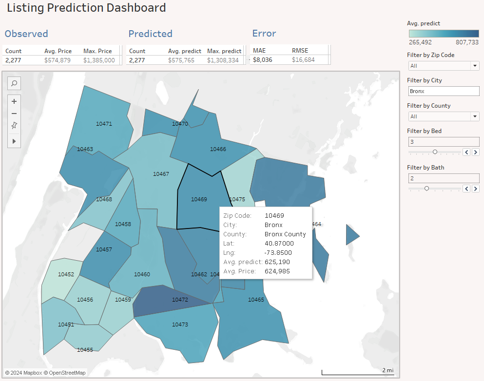
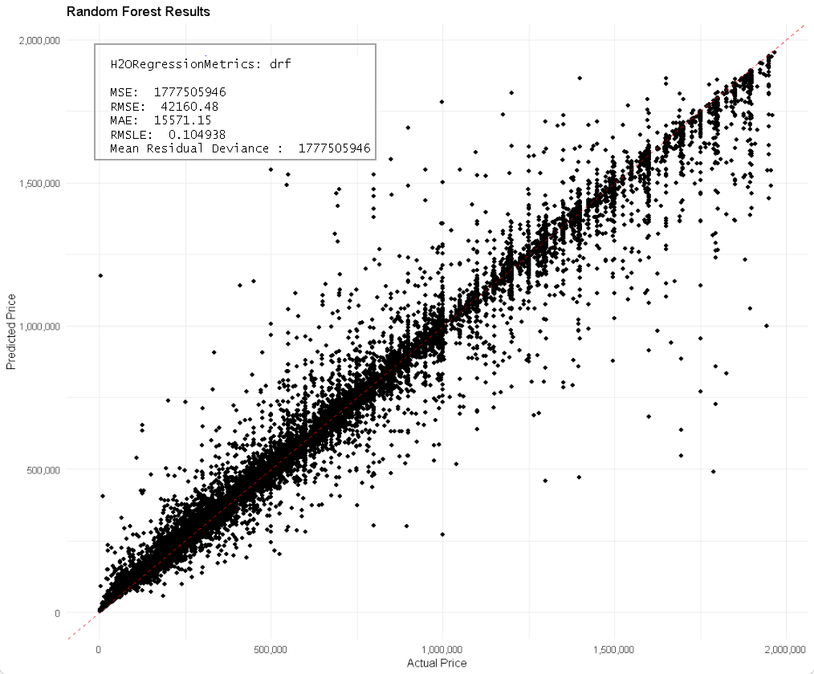
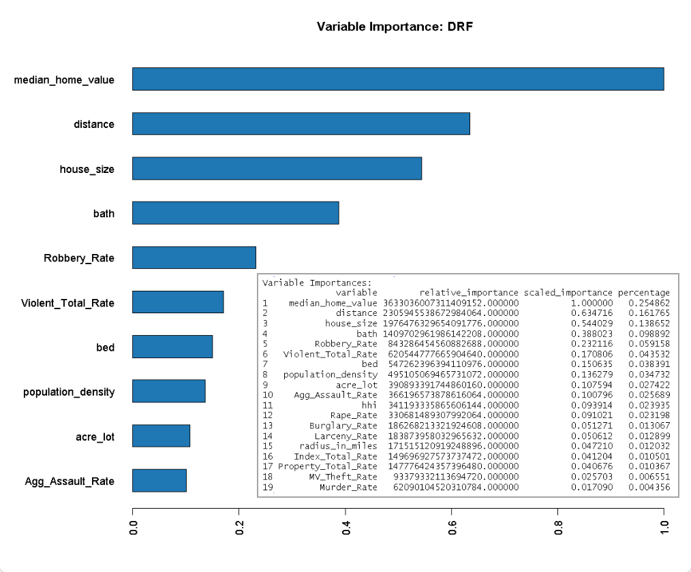

# New York Home Price Prediction (R, H2O, Tableau)

Predicts New York home listing prices from realtor.com listings enriched with zip-code demographics and county crime rates. The final H2O random forest reached a test RMSE of $42K and MAE of $16K, and its predictions feed an interactive Tableau dashboard. I built it for a graduate Data-Driven Decision Making course project (Spring 2024).

## Approach

I followed CRISP-DM and looped back to data preparation when the first models fell short.

1. **Explore and clean.** Filtered 1.4M US listings to New York (653,061), then treated outliers and missing values.
2. **Reduce dimensions.** PCA collapsed bedrooms, bathrooms and house size into one component (PC1).
3. **First models.** Neural nets in `nnet` and `neuralnet` (grid searched with `caret`, with and without PC1) struggled to converge, even on overnight runs. H2O deep learning converged: a 10-model grid search over activation, hidden layers and epochs with 5-fold cross-validation. I also ran linear regression and a local `randomForest` (5 to 150 trees, in parallel with `doParallel`). The best of these early models, the H2O neural network, still missed by $324K RMSE.
4. **Enrich the data.** This was the turning point. A zip code is a label, so on its own it tells a model nothing. I used `zipcodeR` as a crosswalk from each listing's zip code to median household income, median home value, population density, housing units, county, and distance in miles from a reference Manhattan zip code (10282). County then linked each listing to New York State 2022 crime rates. Under 1% of rows dropped in the joins, leaving 338K listings.
5. **Final model.** H2O distributed random forest: 500 trees, max depth 30, 5-fold cross-validation, 70/30 train/test split. About 25 minutes to build.
6. **Deliver.** The script joins predictions back to each listing (`data/RF_all.csv`), and Tableau reads that file.

## Results

Test-set performance:

| Model | Features | RMSE | MAE |
|---|---|---|---|
| H2O neural network (best of a 10-model grid) | Acre lot, PC1, household income | $324,246 | $245,507 |
| H2O random forest (final) | Listing features, zipcodeR demographics, distance, county crime rates | $42,160 | $15,571 |

The random forest also scored an RMSLE of 0.105. The two rows used different feature sets, so the gap reflects the data enrichment as much as the change of algorithm. That was the main lesson: richer location data moved accuracy far more than tuning did.

The top drivers were median home value for the zip code (25% of importance), distance from Manhattan (16%), house size (14%) and bathrooms (10%). Robbery and violent crime rates came next.

| Predicted vs actual | Variable importance |
|---|---|
|  |  |

The neural network grid search results are in `images/h2o_nn_grid_search.png`.

## Tableau dashboard

`tableau/listing_prediction_dashboard.twb` (Tableau Desktop 2021.4) reads `data/RF_all.csv`:

- Cards compare observed and predicted listing count, average price and maximum price, with MAE and RMSE for whatever is filtered.
- A map by zip code is shaded by average predicted price. Tooltips show city, county, and predicted vs actual price.
- Filters cover zip code, city, county, bedrooms and bathrooms.

In the screenshot, 3-bed, 2-bath listings in the Bronx average $574,879 observed vs $575,765 predicted across 2,277 listings, with an MAE of $8,036.

## Files

| File | What it covers |
|---|---|
| `R/01_explore_clean_model.R` | Full pipeline: exploration, cleaning, PCA, neural nets, linear regression, random forest variants, zipcodeR and crime enrichment, final H2O random forest, and the `RF_all.csv` export for Tableau. Sends an SMS with `textme` when a long run finishes |
| `R/02_network_model.R` | Earlier neural network pass with zip-code household income |
| `R/03_network_redo.R` | Second pass at the enriched models |
| `tableau/listing_prediction_dashboard.twb` | Tableau dashboard over the random forest predictions |
| `images/` | Dashboard screenshot and model output charts |

## Data

None of the data is included here. Save the downloads in `data/`:

- [USA Real Estate Dataset](https://www.kaggle.com/datasets/ahmedshahriarsakib/usa-real-estate-dataset) (realtor.com listings) by Ahmed Shahriar Sakib on Kaggle, saved as `data/realEstate.zip`. These scripts used the version downloaded in early 2024 (1.4M rows). Kaggle has updated the dataset since, so row counts may differ.
- Zillow weekly median sale price, saved as `data/zillow_median_sale_price_week.csv`
- New York State Index Crime 2022, saved as `data/NYS_Index_Crime_2022.csv`

H2O needs Java. `textme` reads its Twilio settings from your own environment, and none are stored here.

## Limitations and next steps

- Location stops at the zip code. School zone, neighborhood or address-level data would likely help.
- The listings lack property age, condition, HOA fees and amenities.
- The data is a single 2023 snapshot with a random split. A time-based split would better test how the model holds up on new listings.
